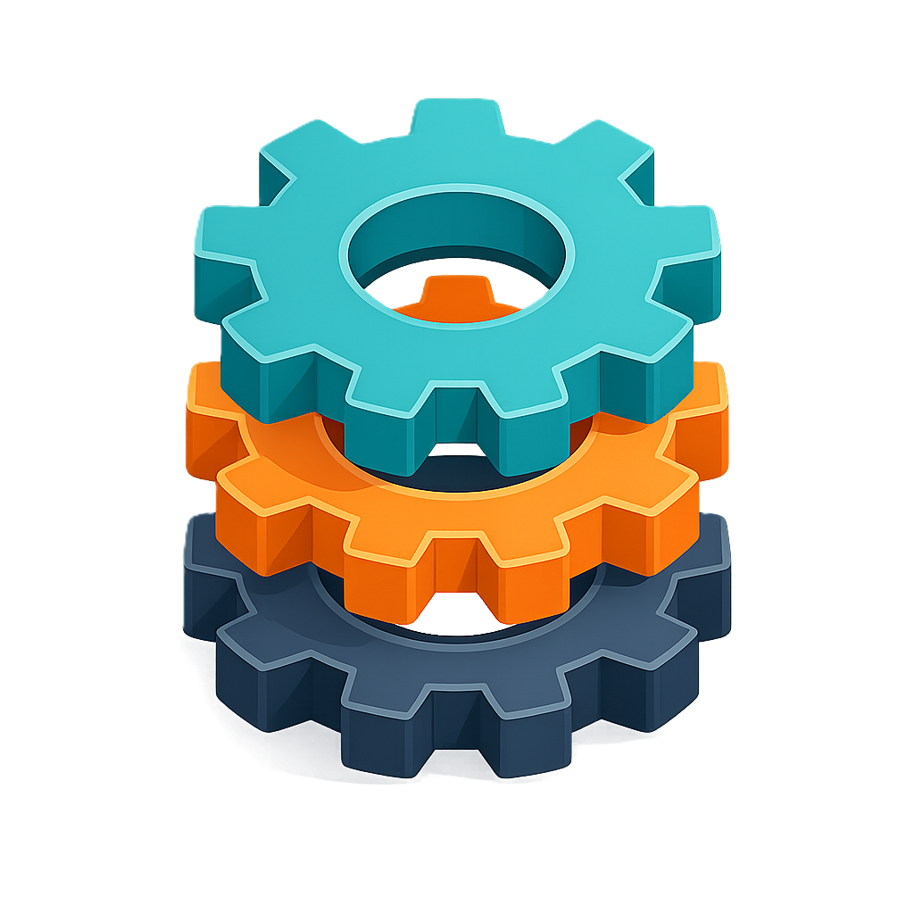
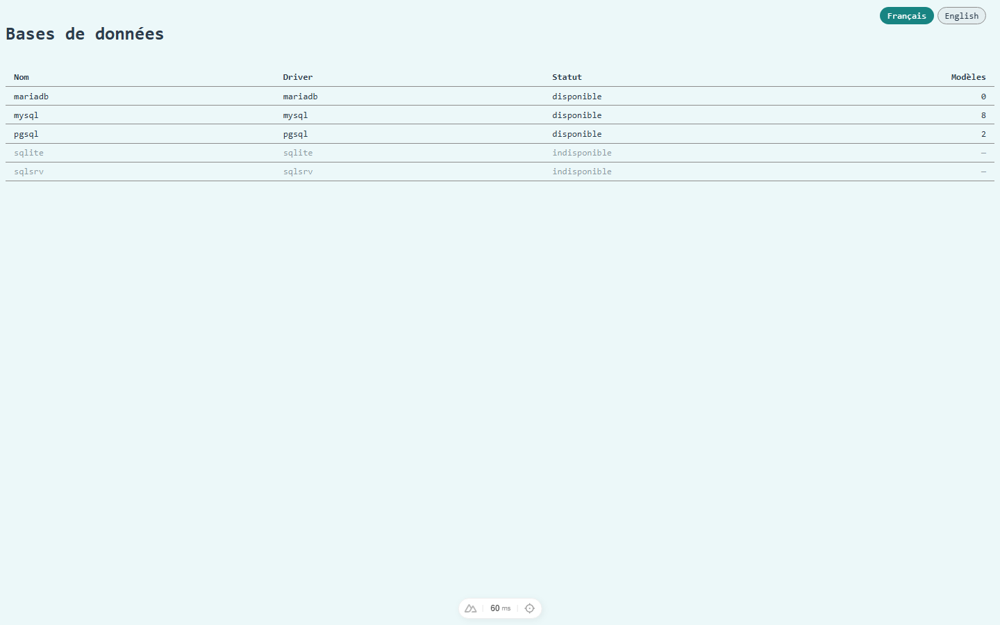
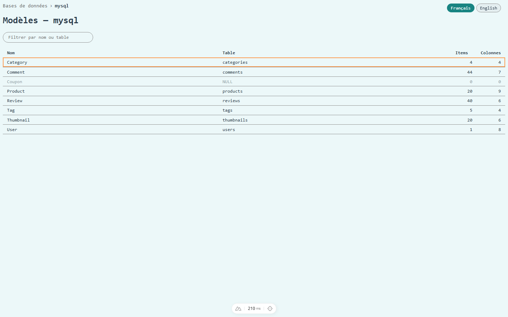
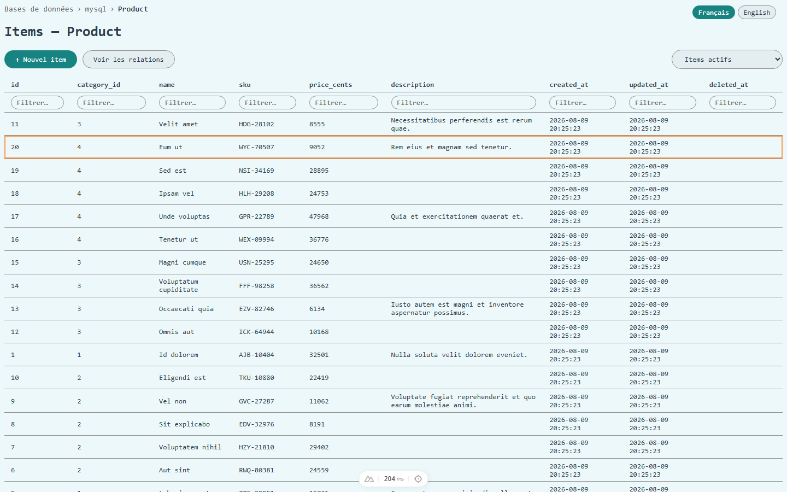
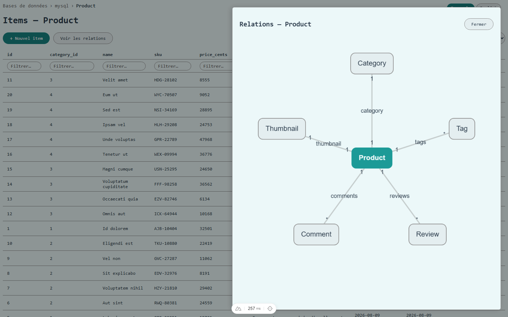
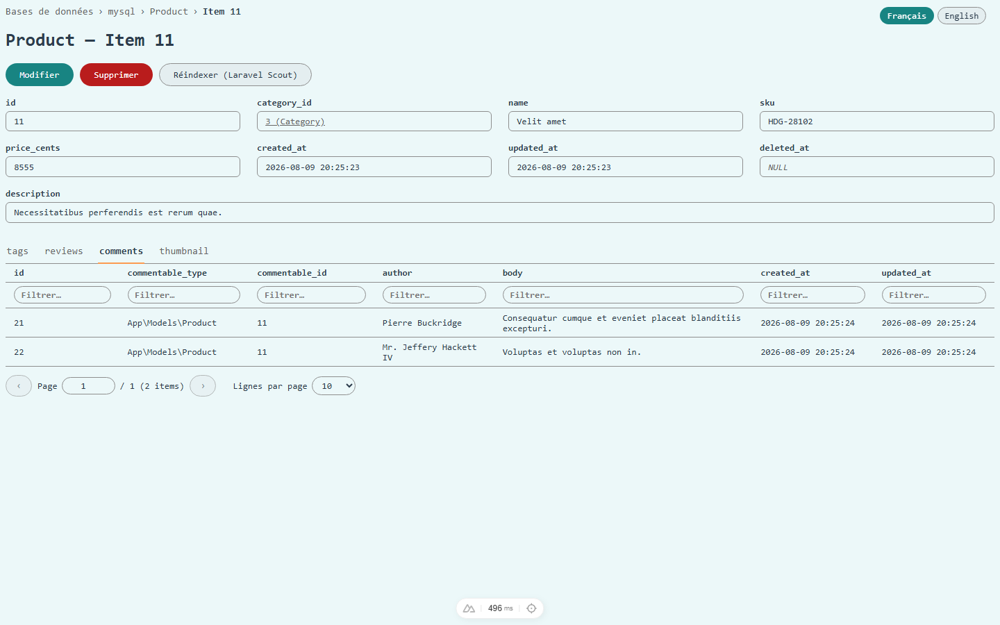

<h1 align="center">
    <br />
    Modelbase
</h1>

Plug-in Laravel de gestion des données d'une application Laravel : parcours des connexions de bases de données, des modèles Eloquent qu'elles contiennent, et de leurs items — sans données propres au plug-in (tout est introspecté dynamiquement depuis l'application hôte).

**Ce n'est pas une base de données mais une base de modèles.**  
**This is not a database but a modelbase.**

</td>
</tr>
</table>

<table border="0" cellspacing="0" cellpadding="0" style="border:none;border-collapse:collapse;">
<tr style="border:none;">
<td width="50%" style="border:none;"></td>
<td width="50%" style="border:none;"></td>
</tr>
<tr style="border:none;">
<td style="border:none;">Connexions de bases de données, avec statut et nombre de modèles résolus dynamiquement</td>
<td style="border:none;">Modèles Eloquent d'une connexion, avec table, nombre d'items et de colonnes</td>
</tr>
<tr style="border:none;">
<td style="border:none;"></td>
<td style="border:none;"></td>
</tr>
<tr style="border:none;">
<td style="border:none;">Items d'un modèle, filtrables par colonne</td>
<td style="border:none;">Diagramme des relations du modèle, accessible depuis la liste des items</td>
</tr>
<tr style="border:none;">
<td colspan="2" style="border:none;"></td>
</tr>
<tr style="border:none;">
<td colspan="2" style="border:none;">Détail d'un item : clé étrangère résolue (<code>category_id</code>) et relation polymorphique (<code>comments</code>) avec les objets liés</td>
</tr>
</table>

## Prérequis

- PHP 8.2+ (8.3+ si l'app hôte utilise Laravel 13, qui l'exige)
- Laravel 11, 12 ou 13
- Docker + docker-compose (pour l'environnement de dev/test)

> Limite connue sous Laravel 11 : une colonne JSON sur une connexion **sqlite** est indiscernable d'une colonne string à l'introspection (`SQLiteGrammar::typeJson()` ignore `use_native_json` avant Laravel 12) — sans effet sur mysql/pgsql, qui exposent nativement un type `json`.

## Installation dans une application hôte

```bash
composer require quatrebarbes/modelbase
php artisan vendor:publish --tag=modelbase-config
```

La configuration (`config/modelbase.php`) permet de personnaliser le préfixe des routes du plug-in, le guard d'authentification utilisé (par défaut celui de l'app hôte) et d'exclure certaines connexions du listing.

Le front (Laravel Livewire) est accessible sous `{route_prefix}/app` (`/modelbase/app` par défaut), distinct du segment `{route_prefix}/api` de l'API (EX-105) — les vues et traductions du front sont chargées directement depuis le package, sans étape `vendor:publish` (EX-120). Le diagramme de relations (module 3) charge Cytoscape.js depuis un CDN public au premier affichage (cdnjs, puis jsDelivr, puis unpkg en repli, avec contrôle d'intégrité SRI — EX-121) : le navigateur de l'utilisateur doit pouvoir joindre au moins l'un d'eux, et une politique CSP de l'app hôte doit les autoriser dans `script-src`. À défaut, seul le diagramme affiche une erreur.

Une app hôte ayant publié l'ancien asset (`vendor:publish --tag=modelbase-diagram-assets`, versions antérieures) peut supprimer `public/{route_prefix}/diagram-assets/`, devenu inutilisé.

> ⚠️ **Avertissement sécurité** : le plug-in n'applique aucune restriction basée sur un rôle ou un droit utilisateur — tout utilisateur authentifié via le guard configuré a un accès en lecture et en écriture (création, modification, suppression) à l'ensemble des connexions, modèles et items exposés par l'application hôte. Ne jamais activer ce plug-in sur un guard accessible à des utilisateurs non-privilégiés (clients, etc.) : configurez `modelbase.guard` sur un guard dédié aux seules personnes de confiance (ex. les administrateurs), ou restreignez l'accès aux routes du plug-in (préfixe `modelbase.route_prefix`) en amont, au niveau de l'application hôte.

## Structure du repo

- [src/](src/), [config/](config/), [routes/](routes/) — le package Laravel (`Quatrebarbes\Modelbase\`), y compris les composants Livewire du front (`src/Livewire/`)
- [resources/views/livewire/](resources/views/livewire/), [resources/lang/](resources/lang/), [resources/css/](resources/css/) — vues, traductions et feuille de style du front, chargées directement depuis le package
- [resources/js/](resources/js/) — script du diagramme de relations, inliné par le layout (Cytoscape.js chargé depuis CDN, cf. ci-dessus)
- [demo/](demo/) — application Laravel hôte de démonstration, utilisée uniquement en dev/test
- [docker-compose.yml](docker-compose.yml) — environnement de dev/test (app de démo + mysql + pgsql)
- [docs/roadmap.md](docs/roadmap.md) — plan de développement et avancement
- [docs/sfd/](docs/sfd/) — spécifications fonctionnelles détaillées

## Développement

Lancer l'environnement complet (app hôte + mysql + pgsql, migrations et seed exécutés automatiquement) :

```bash
docker compose up -d
```

- L'app de démo est disponible sur `http://localhost:8000`, avec le plug-in requis en local via un repository `path` composer.
- Aucune authentification n'existe encore côté app de démo (pas de Breeze/Fortify) : une route `GET /dev-login` (active uniquement en environnement `local`) permet d'ouvrir une session pour l'utilisateur seedé avant d'utiliser le front — à visiter une fois dans le navigateur (`http://localhost:8000/dev-login`), puis `http://localhost:8000/modelbase/app`.

## Montée de version de Cytoscape.js

La version et le hash d'intégrité sont figés dans `resources/js/relation-diagram.js` (`CYTOSCAPE_SOURCES`, `CYTOSCAPE_INTEGRITY`). Après avoir changé la version dans les trois URL, recalculer le hash et vérifier que les trois CDN servent bien le même fichier :

```bash
for u in https://cdnjs.cloudflare.com/ajax/libs/cytoscape/X.Y.Z/cytoscape.min.js \
         https://cdn.jsdelivr.net/npm/cytoscape@X.Y.Z/dist/cytoscape.min.js \
         https://unpkg.com/cytoscape@X.Y.Z/dist/cytoscape.min.js; do
  echo "sha384-$(curl -sL "$u" | openssl dgst -sha384 -binary | openssl base64 -A)"
done
```

## Tests

```bash
composer install
composer test
```

Tests Feature par endpoint API, tests Unit par fonction non triviale (introspection de schéma, résolution de FK...).
