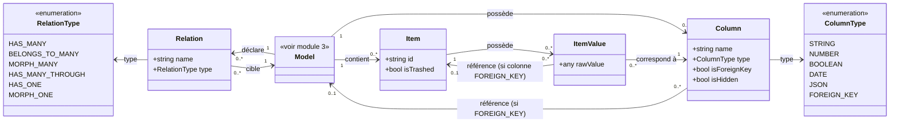
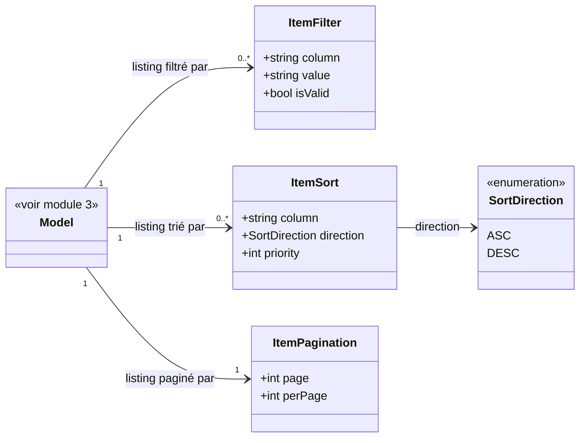

# 4. Items

## Contexte

Ce module permet à un utilisateur de l'application hôte de parcourir, créer, modifier et supprimer les items (enregistrements) d'un modèle sélectionné (module 3). Il s'agit de la dernière étape du parcours : Base de données (module 2) → Modèles (module 3) → Items (ce module).

Un « item », au sens métier de ce module, correspond à un enregistrement d'un modèle. Chaque item porte une valeur pour chacune des colonnes définies par ce modèle.

## Modèle de données

`Item.isTrashed` ne prend une valeur pertinente que pour un modèle hôte utilisant le trait Eloquent `SoftDeletes` ; il vaut toujours `false` pour les autres (cf. « Gestion des items soft-deleted » ci-dessous).

`Column.isHidden` indique qu'une colonne de la table est déclarée masquée par le modèle hôte (cf. « Masquage des colonnes » ci-dessous) : seul son nom est connu du module, jamais sa valeur.

`ItemFilter.column`/`ItemSort.column` désignent une colonne parmi celles exposées par le modèle (EX-422). `ItemFilter.isValid` indique si la valeur saisie respecte le format accepté par le type de la colonne ; seul un filtre valide est appliqué au listing (cf. « Saisie d'un filtre invalide » ci-dessous). `ItemSort.priority` détermine l'ordre d'application lorsque plusieurs colonnes sont triées simultanément (cf. « Tri du listing des items » ci-dessous). `ItemPagination.perPage` est restreint à un ensemble de valeurs prédéfinies (cf. « Pagination du listing des items » ci-dessous).

## Fidélité à la modélisation Eloquent

**Exigence EX-422** ► Les colonnes d'un modèle sont lues à partir du code de l'application hôte (attributs Eloquent) ; leur type de rendu (EX-407) est déduit en priorité du cast Eloquent déclaré sur la colonne, et à défaut du schéma de la base de données. ◄

**Exigence EX-423** ► Les relations entre modèles (clés étrangères) s'appuient sur la modélisation Eloquent déclarée dans l'application hôte plutôt que sur les seules contraintes de la base de données. ◄

**Exigence EX-474** ► La correspondance entre un cast Eloquent reconnu et un type de rendu (EX-407) est la suivante : `boolean`/`bool` → booléen ; `integer`/`int`/`real`/`float`/`double`/`decimal:*` → nombre ; `date`/`datetime`/`immutable_date`/`immutable_datetime`/`custom_datetime:*`/`timestamp` → date ; `array`/`json`/`collection`/`object`/`encrypted:array`/`encrypted:json`/`encrypted:collection`/`encrypted:object` → JSON ; `string`/`encrypted` → texte. ◄

Une colonne détectée comme clé étrangère (EX-423, via une relation Eloquent ou, à défaut, une contrainte de clé étrangère de la base) conserve ce rendu quel que soit un cast scalaire éventuellement déclaré dessus (ex. cast `integer` sur une colonne `*_id`).

Un cast non couvert par la correspondance de EX-474 (classe de cast personnalisée implémentant `CastsAttributes`, cast d'énumération, `AsCollection` et assimilés, ou toute valeur de cast non reconnue) ne modifie pas le type déduit : celui-ci reste déduit du schéma de la base de données, comme pour une colonne sans cast.

Le caractère « texte long » d'une colonne (type SQL text/mediumtext/longtext, EX-450/EX-463) reste dans tous les cas déduit du schéma de la base de données, quel que soit le cast déclaré : aucun cast Eloquent ne porte cette information.

**Exigence EX-424** ► Toute création, modification ou suppression d'un item déclenche les événements Eloquent correspondants (creating/created, updating/updated, deleting/deleted) du modèle hôte. ◄

L'écriture, par des instances Eloquent réelles plutôt que par de simples enregistrements en base, vise à permettre des actions manuelles ponctuelles respectant les règles métier déclenchées par ces événements. Les développeurs utilisant Laravel Scout, en particulier, évitent ainsi toute désynchronisation du cache de recherche lors d'une modification via ce module.

## Masquage des colonnes

Le module ne doit jamais révéler davantage de données que l'application hôte elle-même : une colonne que le modèle hôte déclare masquée (mot de passe haché, jeton, etc.) n'est restituée par aucune vue.

**Exigence EX-477** ► Une colonne doit être considérée comme masquée dès lors que le modèle hôte la déclare masquée (propriété `$hidden` ou attribut `#[Hidden]`), ou dès lors que le modèle hôte déclare une liste non vide de colonnes visibles (propriété `$visible` ou attribut `#[Visible]`) qui ne la contient pas. ◄

**Exigence EX-478** ► Une colonne masquée (EX-477) doit être exclue des colonnes exposées par le modèle (EX-422), même lorsqu'elle est par ailleurs fillable, castée, technique ou clé étrangère d'une relation déclarée. ◄

**Exigence EX-479** ► La clé primaire d'un modèle doit rester exposée (EX-422) en toutes circonstances, y compris lorsque le modèle hôte la déclare masquée (EX-477). ◄

**Exigence EX-480** ► Le caractère masqué d'une colonne doit être déterminé à partir de la seule déclaration du modèle hôte, sans aucun accès à la source de données, afin que la règle s'applique à l'identique quel que soit le type de connexion du modèle (base SQL ou source non SQL telle que ServiceNow). ◄

**Exigence EX-481** ► La valeur d'une colonne masquée ne doit être restituée à aucun utilisateur, quels que soient ses droits, ni être proposée à la saisie lors de la création ou de la modification d'un item, ni pouvoir servir de critère de filtre ou de tri, y compris lorsque ce critère est fourni directement dans l'URL. ◄

> [!WARNING]
> Une colonne masquée étant absente du formulaire, sa valeur enregistrée reste inchangée lors de la modification d'un item ; à la création, une colonne masquée obligatoire et sans valeur par défaut rend la création impossible via ce module, l'erreur renvoyée étant remontée à l'utilisateur comme toute autre erreur de validation.

> [!WARNING]
> Seule la déclaration du modèle hôte fait foi : un masquage ou un démasquage ponctuel appliqué à une instance à l'exécution (`makeHidden()`/`makeVisible()`) n'est pas pris en compte. Pour un tableau d'objets liés, c'est la déclaration du modèle lié qui s'applique.

## Listing des items

**Exigence EX-401** ► Le système liste les items d'un modèle sélectionné sous forme de tableau, une ligne par item. ◄

**Exigence EX-402** ► Pour chaque item listé, le système affiche un aperçu des valeurs de toutes les colonnes exposées par le modèle (EX-422), et de celles-ci uniquement. ◄

> [!WARNING]
> Une colonne réellement présente dans la table sous-jacente mais absente de l'ensemble exposé par le modèle (EX-422 — ni fillable, ni castée, ni technique, ni clé étrangère d'une relation déclarée, ou masquée selon EX-478) n'apparaît pas dans le listing, même si elle est techniquement disponible dans la ligne brute renvoyée par la requête. Cette colonne étant par ailleurs hors du périmètre du filtre et du tri (chapeau du diagramme ci-dessus, EX-432, EX-435), le listing ne présente ainsi jamais de colonne sans filtre ni tri disponible.

**Exigence EX-476** ► L'ordre d'affichage des colonnes du listing (EX-402) suit systématiquement l'ordre des colonnes exposées par le modèle (EX-422), que le listing contienne des items ou non. ◄

Cet ordre ne se déduit jamais du contenu réellement renvoyé par la requête en cours (ex. ordre des clés de la première ligne d'une page) : deux pages d'un même listing, ou deux exécutions successives de la même page, présentent ainsi toujours leurs colonnes dans le même ordre. Les tableaux d'objets liés (EX-427), qui suivent « la même logique d'aperçu que le listing standard », appliquent cette même règle d'ordre.

**Exigence EX-403** ► Le listing des items est paginé ; l'utilisateur peut naviguer entre les pages. ◄

**Exigence EX-469** ► Dans l'aperçu d'une cellule (EX-402), une valeur dont le rendu dépasse trois lignes est tronquée à ces trois lignes, avec une ellipse signalant la troncature, afin de conserver des lignes de tableau de hauteur maîtrisée. ◄

Cette troncature (EX-469) est un rendu purement visuel de l'aperçu : la valeur complète reste consultable sur la fiche détail de l'item (EX-406), sans action dédiée de type « voir plus » depuis le listing.

**Exigence EX-404** ► Si le modèle sélectionné ne contient aucun item, le listing affiche un message indiquant l'absence d'item disponible, sans erreur. ◄

Si la table du modèle sélectionné n'existe pas réellement dans la base de données de sa connexion (ex. migration non exécutée), le listing se comporte comme pour un modèle sans aucun item (EX-404), plutôt que de provoquer une erreur.

## Pagination du listing des items

**Exigence EX-452** ► L'utilisateur peut choisir le nombre de lignes affichées par page du listing, parmi un ensemble de valeurs prédéfinies. ◄

L'ensemble des valeurs prédéfinies proposées pour le nombre de lignes par page (ex. 10/25/50/100) n'est pas figé par cette exigence ; leur choix est un point d'implémentation, sous réserve de rester raisonnable au regard des performances.

**Exigence EX-453** ► L'utilisateur peut accéder directement à n'importe quelle page du listing, sans devoir naviguer page par page. ◄

**Exigence EX-454** ► Si le numéro de page demandé est inférieur à 1 ou supérieur au nombre de pages disponibles, le système affiche respectivement la première ou la dernière page, sans afficher d'erreur. ◄

**Exigence EX-455** ► Le nombre de lignes par page choisi par l'utilisateur est mémorisé et réappliqué lors de ses accès ultérieurs à un listing paginé. ◄

**Exigence EX-456** ► Cette mémorisation est propre à chaque contexte de listing (un modèle donné en listing standard, une relation donnée en tableau d'objets liés) : elle ne partage pas une valeur unique entre tous les listings de l'utilisateur. ◄

Cette logique de pagination (EX-452 à EX-456) est celle référencée par le listing standard (EX-403) et les tableaux d'objets liés (EX-429) : le choix du nombre de lignes par page et l'accès direct à une page sont donc disponibles sur chacun de ces listings, chacun gérant sa propre page courante et son propre nombre de lignes par page indépendamment des autres.

## Filtrage du listing des items

**Exigence EX-432** ► Le listing des items d'un modèle peut être filtré, côté serveur, par une valeur fournie pour une ou plusieurs de ses colonnes. ◄

**Exigence EX-433** ► ~~Pour une colonne de type texte, le filtre retient les items dont la valeur contient la valeur fournie, indépendamment de la casse ; pour les autres types de colonne, le filtre retient les items dont la valeur est strictement égale à la valeur fournie.~~ ◄ *(supprimée)*

**Exigence EX-434** ► Lorsque plusieurs filtres de colonnes sont appliqués simultanément, seuls les items satisfaisant l'ensemble de ces filtres sont retenus. ◄

**Exigence EX-475** ► Quelle que soit la largeur de sa colonne, un champ de filtre occupe au moins la largeur de 3 caractères, afin de rester lisible. ◄

## Filtre des colonnes texte, nombre, booléen et clé étrangère

La valeur d'un filtre est interprétée selon le type de rendu de sa colonne (EX-407). Les règles ci-dessous et celles de la section suivante remplacent EX-433, qui imposait une égalité stricte pour tout type autre que texte.

**Exigence EX-484** ► Pour une colonne de type texte, le filtre doit retenir les items dont la valeur contient la valeur saisie, sans tenir compte de la casse ; toute saisie y est valide. ◄

**Exigence EX-485** ► Pour une colonne de type nombre, la saisie doit être composée de chiffres, éventuellement précédés d'un signe moins et comportant au plus un séparateur décimal, point ou virgule indifféremment ; le filtre doit retenir les items dont la valeur est numériquement égale à la valeur saisie. ◄

**Exigence EX-486** ► Pour une colonne de type booléen, le filtre doit être proposé sous la forme d'une liste à 3 choix, « Tous », « Oui » et « Non », « Tous » correspondant à l'absence de filtre sur la colonne ; aucune saisie libre n'y est possible. ◄

**Exigence EX-487** ► Pour une colonne de type clé étrangère, le filtre doit retenir les items dont la valeur brute est strictement égale à la valeur saisie, sans résolution vers l'item référencé ni contrôle de format de la saisie. ◄

> [!WARNING]
> Pour une colonne de type nombre, « 12 », « 12.0 » et « 12,0 » désignent la même valeur et retiennent donc les mêmes items. À l'inverse, une saisie comportant des espaces (séparateur de milliers), une notation scientifique ou plusieurs séparateurs décimaux est invalide.

## Filtre des colonnes de date et d'heure

Une colonne de type date peut porter une date seule, une date et une heure, ou une heure seule. Dans tous les cas, la saisie se fait au format ISO, quelle que soit la langue de l'interface, et désigne une **période** plus ou moins précise selon le nombre de composantes saisies.

**Exigence EX-488** ► Pour une colonne portant une date et une heure, la saisie doit respecter l'un des formats `AAAA`, `AAAA-MM`, `AAAA-MM-JJ`, `AAAA-MM-JJ HH`, `AAAA-MM-JJ HH:MM` ou `AAAA-MM-JJ HH:MM:SS`, la date et l'heure étant séparées par une espace ou par la lettre `T`. ◄

**Exigence EX-489** ► Pour une colonne portant une date seule, la saisie doit respecter l'un des formats `AAAA`, `AAAA-MM` ou `AAAA-MM-JJ` ; une saisie comportant une heure y est invalide. ◄

**Exigence EX-490** ► Pour une colonne portant une heure seule, la saisie doit respecter l'un des formats `HH`, `HH:MM` ou `HH:MM:SS`. ◄

**Exigence EX-491** ► Le filtre d'une colonne de date ou d'heure doit retenir les items dont la valeur appartient à la période désignée par la saisie, de son début inclus à son début suivant exclu : `2024` retient l'année 2024, `2024-03` le mois de mars 2024, `2024-03-15` la journée du 15 mars 2024, `14` la plage de 14:00:00 à 14:59:59, et une saisie à la seconde ne retient que cette seconde exacte. ◄

> [!WARNING]
> Une saisie au bon format mais désignant une date ou une heure inexistante (`2024-02-30`, `2024-13`, `25:00`) est invalide, au même titre qu'une saisie mal formée.

> [!WARNING]
> La période désignée par la saisie s'entend dans le même fuseau horaire que celui des valeurs affichées dans le listing : un item affiché au 15 mars 2024 doit être retenu par le filtre `2024-03-15`, même si sa valeur est stockée dans un autre fuseau.

## Saisie d'un filtre invalide

**Exigence EX-492** ► Une valeur de filtre doit être considérée comme invalide dès lors qu'elle ne respecte pas le format accepté par le type de sa colonne (EX-485, EX-488 à EX-490) ; une valeur invalide ne doit jamais provoquer d'erreur d'affichage du listing. ◄

**Exigence EX-493** ► Dans le front, un filtre invalide ne doit pas être appliqué, les autres filtres valides doivent continuer à s'appliquer et la saisie de l'utilisateur doit être conservée telle quelle dans le champ. ◄

**Exigence EX-494** ► Dans le front, tant que sa saisie reste invalide, le champ d'un filtre doit être signalé visuellement et accompagné d'un message indiquant le format attendu pour le type de sa colonne. ◄

**Exigence EX-495** ► Via l'API, une requête comportant au moins une valeur de filtre invalide doit être rejetée par une réponse d'erreur nommant chaque colonne en cause et le format attendu, sans renvoyer d'items, au même titre qu'une colonne inconnue ou non exposée (EX-432). ◄

> [!WARNING]
> Le filtre étant appliqué au fil de la saisie, une date en cours de frappe passe par des états successivement invalides et valides : `202` est invalide (filtre ignoré), `2024` est valide (filtre sur l'année), `2024-` redevient invalide (filtre ignoré), puis `2024-03` est valide (filtre sur le mois). Le listing alterne donc entre un état filtré et un état non filtré sur cette colonne pendant la frappe ; c'est le comportement attendu, et le signalement d'EX-494 rend l'état courant explicite.

## Tri du listing des items

**Exigence EX-435** ► Le listing des items peut être trié selon une ou plusieurs de ses colonnes, chacune associée à un ordre croissant ou décroissant. ◄

**Exigence EX-436** ► Lorsque le tri porte sur plusieurs colonnes, celles-ci sont appliquées selon un ordre de priorité déterminé par l'utilisateur. ◄

## Filtrage et tri des tableaux d'objets liés

**Exigence EX-470** ► Le filtre (EX-432 à EX-434, EX-484 à EX-495) et le tri (EX-435, EX-436) sont également disponibles sur chaque tableau d'objets liés (EX-425 à EX-431), au même titre que sur le listing standard. ◄

**Exigence EX-471** ► Le filtre et le tri d'un tableau d'objets liés s'appliquent indépendamment de ceux des autres tableaux d'objets liés et du listing standard : chacun conserve son propre état, à l'image de la pagination (EX-456). ◄

**Exigence EX-472** ► Le filtre et le tri d'un tableau d'objets liés ne portent que sur les colonnes exposées par le modèle lié (EX-427) ; les attributs propres à la table pivot d'une relation belongsToMany en sont exclus, au même titre qu'ils ne sont pas affichés dans l'aperçu. ◄

**Exigence EX-473** ► Si le modèle ciblé par une relation appartient à une connexion indisponible (EX-431), aucun filtre ni tri n'est proposé pour le tableau correspondant. ◄

## Consultation du détail d'un item

**Exigence EX-405** ► La sélection d'un item dans le listing navigue vers sa fiche détail. ◄

**Exigence EX-406** ► La fiche détail d'un item affiche la valeur de toutes ses colonnes. ◄

**Exigence EX-407** ► Chaque valeur de colonne est affichée selon un rendu adapté à son type (texte, nombre, date, booléen, JSON). ◄

**Exigence EX-408** ► Une valeur de colonne de type clé étrangère est affichée comme un lien de navigation vers l'item référencé, dans son propre modèle. ◄

**Exigence EX-409** ► Une valeur de colonne nulle est affichée avec un rendu distinct d'une valeur renseignée (y compris une chaîne vide). ◄

**Exigence EX-410** ► Si une clé étrangère référence un item supprimé ou inexistant, la valeur est affichée sans lien de navigation, accompagnée d'un indicateur signalant que l'item référencé est introuvable. ◄

> [!IMPORTANT]
> La résolution d'une clé étrangère en lien de navigation (EX-408) ne recherche le modèle référencé que parmi ceux déclarés sur la même connexion que l'item consulté : une clé étrangère pointant vers une autre connexion, même disponible, n'est jamais résolue en lien navigable et suit le même traitement que EX-410.

**Exigence EX-411** ► Depuis la fiche détail d'un item, l'utilisateur peut revenir au listing des items du modèle. ◄

## Signalement des colonnes masquées d'un item

**Exigence EX-482** ► La fiche détail d'un item (EX-406) doit afficher le nom de chacune des colonnes masquées de son modèle (EX-477), à l'exception de la clé primaire toujours affichée (EX-479), sans jamais afficher leur valeur (EX-481). ◄

**Exigence EX-483** ► Si le modèle ne comporte aucune colonne masquée autre que sa clé primaire, la fiche détail d'un item ne doit afficher aucune mention relative aux colonnes masquées. ◄

> [!WARNING]
> Le nom des colonnes masquées n'est signalé que sur la fiche détail : le listing des items et les tableaux d'objets liés retirent ces colonnes sans aucune mention.

## Disposition en colonnes de la fiche détail et du formulaire

**Exigence EX-448** ► La fiche détail d'un item (EX-406 à EX-410) et son formulaire de création/modification (EX-412 à EX-417) répartissent les champs de colonnes sur plusieurs colonnes visuelles, de façon à occuper au mieux la largeur disponible de l'écran. ◄

**Exigence EX-449** ► Le nombre de colonnes visuelles se recalcule selon la largeur disponible de l'écran, jusqu'à un repli sur une colonne unique sur les écrans étroits. ◄

**Exigence EX-450** ► Un champ dont le rendu nécessite un espace vertical important, notamment l'éditeur JSON (EX-414) et une colonne de texte long (type SQL text/mediumtext/longtext, par opposition à varchar/char), occupe toute la largeur de la grille plutôt que de partager une colonne visuelle avec un autre champ. ◄

**Exigence EX-463** ► Une colonne de texte long (type SQL text/mediumtext/longtext, par opposition à varchar/char) est rendue via un éditeur multiligne plutôt qu'un simple champ texte, dans le formulaire de création/modification. ◄

**Exigence EX-451** ► L'ordre de répartition des champs dans la grille suit l'ordre des colonnes tel qu'exposé par le modèle (EX-422), sans réordonnancement propre à l'affichage en colonnes, à l'exception des champs occupant toute la largeur de la grille (EX-450) : ceux-ci sont replacés en fin de grille, après tous les autres champs, pour éviter qu'un champ pleine largeur au milieu de la répartition n'interrompe les rangées suivantes. ◄

Le nombre exact de colonnes affichées selon la largeur d'écran (points de rupture, largeur minimale d'un champ) n'est pas figé par cette exigence : c'est un choix d'implémentation front, du moment que la largeur disponible est effectivement occupée.

Cette disposition en colonnes ne s'applique qu'aux champs propres de l'item ; les tableaux d'objets liés (EX-425 à EX-431), affichés sous la fiche détail, conservent leur disposition pleine largeur actuelle.

## Affichage des objets liés à un item

**Exigence EX-425** ► La fiche détail d'un item affiche, sous les valeurs de ses colonnes, un tableau distinct pour chaque relation Eloquent déclarée par le modèle hôte vers un autre modèle (hasMany, belongsToMany, morphMany, hasManyThrough, hasOne, morphOne). ◄

**Exigence EX-426** ► Le titre de chaque tableau reprend le nom de la relation tel que déclaré dans le modèle hôte (nom de la méthode Eloquent), afin de distinguer plusieurs relations pointant vers un même modèle lié. ◄

**Exigence EX-427** ► Chaque tableau affiche un aperçu des valeurs de toutes les colonnes exposées par le modèle lié, selon la même logique d'aperçu que le listing standard d'un modèle (EX-402, EX-469). ◄

**Exigence EX-428** ► La sélection d'une ligne dans un tableau d'objets liés navigue vers la fiche détail de l'item correspondant, dans son propre modèle. ◄

**Exigence EX-429** ► Chaque tableau d'objets liés est paginé selon la même logique de pagination que le listing standard d'un modèle (EX-403). ◄

**Exigence EX-430** ► Si une relation ne retourne aucun objet lié, son tableau affiche un message indiquant l'absence d'élément, sans erreur. ◄

**Exigence EX-431** ► Si le modèle ciblé par une relation appartient à une connexion indisponible, le tableau correspondant affiche une indication d'indisponibilité, sans lien de navigation vers ses lignes. ◄

Les attributs propres à la table pivot d'une relation belongsToMany (ex. une date d'association, une quantité) ne sont pas affichés dans le tableau des objets liés : seules les colonnes du modèle lié sont couvertes.

> [!IMPORTANT]
> La création ou la suppression rapide d'un objet lié directement depuis ce tableau n'est pas couverte par cette fonctionnalité ; ces actions passent par la navigation vers la fiche de l'item lié ou vers le listing de son modèle (module 3/4).

## Création et modification d'un item

**Exigence EX-412** ► L'utilisateur peut créer un nouvel item dans un modèle, en renseignant une valeur pour chacune de ses colonnes. ◄

**Exigence EX-413** ► L'utilisateur peut modifier la valeur des colonnes d'un item existant. ◄

**Exigence EX-414** ► Le formulaire de saisie d'une colonne est adapté à son type (champ texte, champ numérique, sélecteur de date, case à cocher, éditeur JSON). ◄

**Exigence EX-415** ► La modification d'une valeur de colonne de type clé étrangère se fait par sélection d'un item existant dans le modèle référencé. ◄

## Restrictions d'édition des colonnes

**Exigence EX-416** ► Les colonnes techniques non éditables (clé primaire, horodatages de création/modification) sont affichées en lecture seule dans le formulaire. ◄

**Exigence EX-417** ► Le formulaire de saisie remonte à l'utilisateur les erreurs de validation renvoyées par les contraintes définies sur la colonne (obligatoire, unicité, format), sans redéfinir ces règles de validation au niveau du plug-in. ◄

**Exigence EX-421** ► Seules les colonnes fillable (mass-assignable, au sens `$fillable`/`$guarded` d'Eloquent) du modèle hôte peuvent être renseignées à la création ou modifiées via ce module. ◄

**Exigence EX-464** ► Une colonne non fillable, hors colonnes techniques (EX-416), est traitée en lecture seule au même titre que ces dernières. ◄

## Modification différentielle d'un item

**Exigence EX-465** ► Lors de la modification d'un item existant (EX-413), seules les colonnes dont l'utilisateur a effectivement changé la valeur par rapport à celle initialement chargée sont transmises au serveur ; une colonne non touchée n'est jamais incluse dans la requête de modification. ◄

**Exigence EX-466** ► Une colonne non touchée par l'utilisateur n'est jamais rejetée ni ne déclenche d'erreur de validation (EX-417), quelle que soit sa valeur actuellement enregistrée. ◄

**Exigence EX-467** ► Pour une colonne de type JSON, la comparaison entre valeur initiale et valeur saisie porte sur le contenu structuré, indépendamment de sa représentation textuelle (formatage, ordre des clés) dans l'éditeur. ◄

**Exigence EX-468** ► Tant qu'aucune colonne n'a été modifiée par rapport aux valeurs initialement chargées, la validation du formulaire de modification n'est pas proposée à l'utilisateur. ◄

Ce comportement différentiel ne s'applique qu'à la modification d'un item existant (EX-413) ; la création d'un item (EX-412) transmet l'ensemble des colonnes renseignées, la notion de valeur « non modifiée » n'ayant pas de sens en l'absence d'item préexistant.

Une colonne en lecture seule (technique, EX-416, ou non-fillable, EX-464) n'étant jamais modifiable par l'utilisateur, elle n'est par construction jamais transmise par cette modification différentielle.

Le rétablissement manuel d'une colonne à sa valeur initiale, après une première modification annulant ainsi le changement, la fait sortir du périmètre de la requête transmise au même titre qu'une colonne jamais touchée : la comparaison porte sur la valeur courante par rapport à la valeur initiale, pas sur un historique des saisies de l'utilisateur.

> [!WARNING]
> Cette exigence réduit le risque qu'une modification écrase une valeur qu'un autre utilisateur aurait changée entre-temps sur une colonne différente du même item, mais ne détecte ni ne bloque une modification concurrente portant sur la même colonne (pas de verrouillage optimiste ni d'horodatage de version) — ce mécanisme de détection de conflit reste hors périmètre.

## Suppression d'un item

**Exigence EX-418** ► L'utilisateur peut supprimer un item existant. ◄

La suppression en masse de plusieurs items simultanément n'est pas couverte par ce module.

**Exigence EX-419** ► Une confirmation est demandée à l'utilisateur avant toute suppression d'item. ◄

**Exigence EX-420** ► Si la suppression d'un item échoue parce qu'il est référencé comme clé étrangère par d'autres items, le système affiche à l'utilisateur, après confirmation, l'erreur d'intégrité référentielle renvoyée par la base de données plutôt que d'appliquer la suppression. ◄

## Gestion des items soft-deleted

**Exigence EX-437** ► Pour un modèle utilisant le trait Eloquent SoftDeletes, le listing standard des items n'affiche par défaut que les items non supprimés. ◄

**Exigence EX-438** ► L'utilisateur peut activer un filtre affichant les items soft-deleted en complément des items actifs, ou les items soft-deleted exclusivement. ◄

**Exigence EX-439** ► Un item soft-deleted affiché est signalé par un indicateur visuel distinctif, dans le listing comme sur sa fiche détail. ◄

**Exigence EX-440** ► Depuis la fiche détail d'un item soft-deleted, l'utilisateur peut le restaurer, ce qui annule sa suppression. ◄

**Exigence EX-441** ► Depuis la fiche détail d'un item soft-deleted, l'utilisateur peut le supprimer définitivement (suppression physique), cette action étant distincte de la suppression standard (EX-418). ◄

**Exigence EX-442** ► Une confirmation est demandée à l'utilisateur avant toute suppression définitive d'un item, en complément de la confirmation déjà requise pour la suppression standard (EX-419). ◄

**Exigence EX-443** ► Pour un modèle n'utilisant pas le trait SoftDeletes, aucune de ces fonctions (filtre, indicateur, restauration, suppression définitive) n'est proposée : la suppression standard (EX-418) y reste physique et immédiate. ◄

> [!IMPORTANT]
> À date, le filtre d'affichage des items soft-deleted et les actions de restauration/suppression définitive ne s'appliquent qu'au listing standard et à la fiche détail d'un item ; les tableaux d'objets liés (EX-425 à EX-431) affichent les objets liés tels que renvoyés par la relation Eloquent, sans filtre de visibilité dédié.

## Mise à jour à la demande du cache de recherche Scout

**Exigence EX-444** ► Pour un modèle utilisant le trait Laravel Scout Searchable, la fiche détail d'un item propose une action déclenchant la mise à jour de son entrée dans l'index de recherche Scout. ◄

Cette exigence ne couvre pas la réindexation en masse de tous les items d'un modèle : seule la mise à jour d'un item à la fois est couverte.

> [!NOTE]
> Si le pilote Scout configuré par l'application hôte est asynchrone (mise en file d'attente), la mise à jour effective de l'index peut ne pas être immédiate ; le plug-in ne fait que déclencher la synchronisation, sans en garantir le délai de traitement.

**Exigence EX-445** ► Cette action invoque le mécanisme de synchronisation Scout du modèle hôte (méthode `searchable()` de l'item), sans réimplémenter de logique d'indexation propre au plug-in. ◄

**Exigence EX-446** ► L'utilisateur reçoit une confirmation visuelle du succès ou de l'échec de la mise à jour de l'index. ◄

**Exigence EX-447** ► Pour un modèle n'utilisant pas le trait Searchable, cette action n'est pas proposée. ◄
